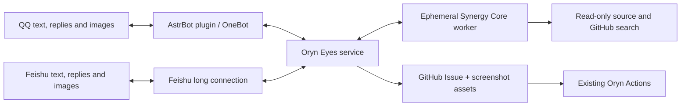

# 👁️ Oryn Eyes

Multimodal QQ and Feishu support and automatic GitHub issue intake, powered by **Synergy Core**. AstrBot/OneBot handles QQ and an independent official-SDK long connection handles Feishu; a small Bun service understands reports, searches GitHub, inspects source, and answers questions or creates an Issue directly. No draft confirmation step, long-term memory, experience store, Web UI, desktop app, or RCM dependency.



## Behavior

- Responds to **group @mentions** and **private messages**, including image-only reports and quoted messages.
- Sends a concise receipt and one final conclusion with the same diagnostic reference, without intermediate progress messages. `@bot stop` cancels the sender's active request.
- Uses recent messages from the same sender and explicit quoted context. Context expires after 30 minutes and disappears on restart.
- Answers usage questions; asks for missing essential information; links existing Issues; directly files clear new bugs, feature requests, and documentation gaps.
- Searches open/closed Issues and PRs through a repository-scoped read gateway. A create/known-issue result requires successful search evidence.
- Downloads source at a specific commit for each task. File citations are checked against actual source lines and quotes. Static evidence is explicitly separated from user descriptions and hypotheses; no execution/reproduction is claimed.
- Sends image bytes through Core attachments to the model. QQ and Feishu images are normalized, resized, and stripped of EXIF metadata. Current and quoted screenshots take precedence over recent images. QQ downloads accept trusted HTTPS CDN hosts, including QQ NT's `multimedia.nt.qq.com.cn`; redirects must stay within the same allowlist.
- Publishes relevant, non-sensitive screenshots to `.oryn-eyes/assets/` on the target repository's `oryn-eyes-assets` branch, linking them in the Issue. This avoids inventing an unsupported GitHub attachment-upload API or changing the development branch.
- Adds readable Issue sections and labels. The host performs all GitHub writes; the model has no GitHub token or write tools.

The existing QQ deployment targets **YourTongji/YourTJ-Hub**. Feishu is an optional independent ingress using the same repository-scoped service. See [Feishu setup and migration](docs/deployment/feishu.md) for app permissions, long connections, environment variables and portable Linux deployment.

## Model and Core

Default model: Zhipu Coding Plan `glm-5.3-flash`, endpoint `https://open.bigmodel.cn/api/coding/paas/v4`, configured context window **1,000,000**, image input, **reasoning effort `max`**, thinking enabled. Any OpenAI-compatible chat endpoint also works through `ORYN_BASE_URL` / `ORYN_API_KEY` / `ORYN_MODEL`, e.g. the SII vLLM deployment of `Qwen3.8-27B` (image input, tool calls, `json_object` and streaming verified against the live endpoint, ~1M-token window). That endpoint accepts reasoning effort only at `none/low/medium` and applies its strongest level with thinking enabled when the field is omitted, so the `max` variant omits `reasoning_effort` and `high` maps to `medium`. Its strict single-leading-system requirement is met by enabling Core's `mergeSystemMessages` provider option, which joins all system prompts into one leading system message. The context number is configuration, not a claim of a full-window capacity benchmark.

Core is pinned by full commit in `config/core.json`, with a frozen dependency lock. `script/install-core.ts` uses Synergy's public package builder and installs only four packages. `synergy-link-protocol` is a protocol dependency; no Link service is deployed.

```bash
bun install --frozen-lockfile
bun run check
bun run core:install
bun run smoke
```

The smoke test verifies **actual provider-bound image bytes**, source reading, GitHub gateway tool access, and reasoning continuation using the real Core. `bun script/smoke.ts --live` additionally calls the configured official GLM endpoint using `ORYN_API_KEY`.

`bun script/publication-smoke.ts --live-write` is an explicit live-write probe: it uploads a generated image, verifies anonymous image access, creates a clearly labelled verification Issue with the existing Oryn hold label, verifies duplicate recovery, and closes that same Issue. It never uses real QQ messages or screenshots.

## Deployment

CI builds and smoke-tests separate Linux x64 and ARM64 bundles containing Core, the application, Bun, and ripgrep. The x64 bundle uses baseline Bun for small x86 machines; ARM64 uses native Bun and a natively compiled Core sandbox helper. Select the bundle matching `uname -m`; do not copy installed dependencies or executable files between architectures. Python 3 is required for safe source extraction. Install the bundle under `~/oryn-eyes` and the unit from `deploy/oryn-eyes.service` under `~/.config/systemd/user/`.

On a shared Raspberry Pi, start with `ORYN_CONCURRENCY=1` in a systemd drop-in and retain the service memory limit. Build packages in CI, keep task data temporary, and bound journal size. Enable user lingering when using user services so they start at boot without an interactive login. Verify QQ login status as well as the OneBot connection: a connected reverse WebSocket does not mean the QQ account is online. A migration may require scanning a new QQ login code.

Keep credentials outside the checkout in `~/.config/oryn-eyes/`, directory mode `0700`, files `0600`:

| File | Contents |
|---|---|
| `model.env` | `ORYN_API_KEY=...` |
| `github.env` | `GITHUB_TOKEN=...` |
| `bridge.env` | `ORYN_BRIDGE_TOKEN=...` |
| `bridge.token` | The same bridge token, without an environment-variable prefix |

The GitHub credential needs Issues read/write, Contents read/write (source and screenshot branch), and repository metadata read. It is never passed to the Core worker. Repository selection is service configuration, not model output.

Copy `astrbot_plugin_oryn_eyes/` into AstrBot's `data/plugins/`, remove/disable the old Chaos bridge, and reload AstrBot. The plugin uses the token file above; `ORYN_EYES_URL`, `ORYN_EYES_TOKEN_FILE`, and `ORYN_EYES_BUDGET_SECONDS` are optional overrides. Pillow is required in AstrBot's Python environment.

```bash
systemctl --user daemon-reload
systemctl --user enable --now oryn-eyes.service
curl --fail http://127.0.0.1:18080/health
journalctl --user -u oryn-eyes.service --since today
```

The service binds to loopback and authenticates all message/status/cancel APIs. Keep it local to AstrBot or put an authenticated transport in front of it. `/health` contains only configuration metadata and queue counts.

## Configuration

| Variable | Default |
|---|---|
| `ORYN_REPOSITORY` | `YourTongji/YourTJ-Hub` |
| `ORYN_MODEL` | `glm-5.3-flash` |
| `ORYN_BASE_URL` | Official Zhipu Coding Plan endpoint |
| `ORYN_BUDGET_SECONDS` | `900` |
| `ORYN_CONCURRENCY` | `2` |
| `ORYN_QUEUE_LIMIT` | `20` |
| `ORYN_PORT` | `18080` |
| `ORYN_GITHUB_ARCHIVE_MIRROR` | Unset (official); optional HTTPS prefix, e.g. `https://ghfast.top`, for public source archives only |
| `ORYN_TEMP_ROOT` | `/tmp/oryn-eyes` |
| `ORYN_PUBLISH` | `true`; `false` enables analysis without publishing |

The task budget bounds the whole task. Provider request timeouts use the remaining budget, with separate first-byte and stream-idle limits. Shutdown cancels workers and removes temporary homes. Stale task directories older than two hours are reclaimed on startup.

## State and limits

Unknown screenshot IDs are corrected inside the existing bounded Core report-correction loop,
within the original task budget. The prompt lists the supplied IDs and requires an empty list
when no relevant image is available. Publication still independently rejects unknown IDs.

Only necessary redacted service diagnostics remain locally. Model sessions, source snapshots and images are temporary. In archive mode, concurrent tasks share an in-memory source archive for at most five minutes, keyed by the exact commit; each task still gets its own extracted workspace. The optional source cache described below persists repository Git objects only. Credentials and installed code are deployment inputs, not memory. Message deduplication and status are in memory for 30 minutes; published Issues carry an opaque marker so repeated deliveries can recover a prior creation from recent Issues. No promise of exactly-once delivery across arbitrary outages is made: ambiguous GitHub writes are checked before any retry, and automatic blind write retries are prohibited.

See [the decision record](docs/decisions/2026-09-12-core-support-service.md) and [upstream provenance](NOTICE.md).

### Source downloads on slower networks

Set `ORYN_SOURCE_CACHE_ROOT` to a host-owned directory to keep a shallow bare Git cache.
Every message resolves the current default-branch commit through GitHub. Missing commits are fetched
incrementally from the official repository with a separate `ORYN_SOURCE_FETCH_TIMEOUT_SECONDS`
limit (default 120 seconds); unchanged commits require no Git transfer. Fetch failures fail the task
explicitly rather than silently using stale source. Git credentials are supplied only to the host's
Git process, never stored in the cache or given to the model.

Each task exports its exact commit into a separate temporary workspace with no `.git` directory.
Concurrent cache access is serialized, while prepared snapshots are independent. The workspace is
removed on completion, failure or cancellation. Startup and a 15-minute maintenance timer remove
orphaned task/worker directories older than two hours; active workspaces are excluded. The persistent
cache contains repository source only, not conversations, screenshots or model history. One service
process owns a cache root. Keep it outside `ORYN_TEMP_ROOT`, on storage accessible only to the service.

Without `ORYN_SOURCE_CACHE_ROOT`, source preparation uses the bounded archive download and optional
public archive mirror. Both modes share the total task budget and preserve safe extraction limits.

`ORYN_GITHUB_ARCHIVE_MIRROR` is an optional operator-trusted download prefix. Only repositories confirmed public by the official GitHub API use it. The service resolves the commit SHA from GitHub first and downloads that SHA's archive through the prefix; GitHub tokens, API calls, Issue writes, and screenshots never go through it. This trusts the mirror to deliver source faithfully: a SHA in the URL alone does not authenticate archive bytes. Leave it unset for official downloads. Mirror failures fail the request within its budget and appear in service logs.

For a shared Pi, `deploy/raspberry-pi.conf` provides concurrency 1 and temporary workspaces on `/dev/shm`; install it as a user-service drop-in after checking available RAM. Memory limits only work when the kernel enables the memory cgroup controller. AstrBot 4.26 requires Python 3.12 or newer and `astrbot init` in its working directory before enabling its service.

### Chat receipts and diagnostic references

QQ receipts keep the two-reply format: `👁️ 收到` with a 12-character hexadecimal log reference, followed by the final conclusion with the same reference. Feishu instead acknowledges accepted feedback with a 👀 (`GLANCE`) reaction on the triggering message; on completion the reaction switches to ✅ (`DONE`) and only the final conclusion is sent. There are no periodic progress messages. The acknowledgement happens before screenshot downloads and service submission, so failures at those steps still produce a final reply. Failed, cancelled and timed-out jobs follow the same closing format. If reactions are unavailable, Feishu falls back to appending the log reference to the final reply, so every handled message still carries a reference.

The reference is generated by the bridge and is not a chat identity. Bridge logs record receipt, terminal status, and the mapping `log_id=… job=…` to the service job ID. Search the bridge journal by the reference, then use the mapped job ID for service diagnostics. References are kept out of model context and GitHub Issues; no additional persistent store is introduced. Explicit `stop` commands retain their immediate control response.
