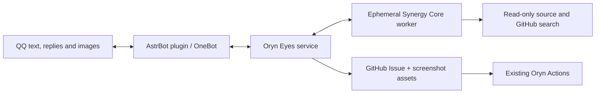

# 👁️ Oryn Eyes

Multimodal QQ support and automatic GitHub issue intake, powered by **Synergy Core**. AstrBot and OneBot handle messaging; a small Bun service understands reports, searches GitHub, inspects source, and answers questions or creates an Issue directly. No draft confirmation step, long-term memory, experience store, Web UI, desktop app, or RCM dependency.



## Behavior

- Responds to **group @mentions** and **private messages**, including image-only reports and quoted messages.
- Sends an immediate receipt and one progress update for longer tasks. `@bot stop` cancels the sender's active request.
- Uses recent messages from the same sender and explicit quoted context. Context expires after 30 minutes and disappears on restart.
- Answers usage questions; asks for missing essential information; links existing Issues; directly files clear new bugs, feature requests, and documentation gaps.
- Searches open/closed Issues and PRs through a repository-scoped read gateway. A create/known-issue result requires successful search evidence.
- Downloads source at a specific commit for each task. File citations are checked against actual source lines and quotes. Static evidence is explicitly separated from user descriptions and hypotheses; no execution/reproduction is claimed.
- Sends image bytes through Core attachments to the model. QQ images are normalized, resized, and stripped of EXIF metadata. Current and quoted screenshots take precedence over recent images.
- Publishes relevant, non-sensitive screenshots to `.oryn-eyes/assets/` on the target repository's `oryn-eyes-assets` branch, linking them in the Issue. This avoids inventing an unsupported GitHub attachment-upload API or changing the development branch.
- Adds readable Issue sections and labels. The host performs all GitHub writes; the model has no GitHub token or write tools.

The current deployment is limited to **YourTongji/YourTJ-Hub**. Feishu and unrelated repositories from the former Chaos installation are intentionally excluded from this QQ deployment.

## Model and Core

Default model: Zhipu Coding Plan `glm-5.3-flash`, endpoint `https://open.bigmodel.cn/api/coding/paas/v4`, configured context window **1,000,000**, image input, **reasoning effort `max`**, thinking enabled. The context number is configuration, not a claim of a full-window capacity benchmark.

Core is pinned by full commit in `config/core.json`, with a frozen dependency lock. `script/install-core.ts` uses Synergy's public package builder and installs only four packages. `synergy-link-protocol` is a protocol dependency; no Link service is deployed.

```bash
bun install --frozen-lockfile
bun run check
bun run core:install
bun run smoke
```

The smoke test verifies **actual provider-bound image bytes**, source reading, GitHub gateway tool access, and reasoning continuation using the real Core. `bun script/smoke.ts --live` additionally calls the configured official GLM endpoint using `ORYN_API_KEY`.

`bun script/publication-smoke.ts --live-write` is an explicit live-write probe: it uploads a generated image, verifies anonymous image access, creates a clearly labelled verification Issue with the existing Oryn hold label, verifies duplicate recovery, and closes that same Issue. It never uses real QQ messages or screenshots.

## Deployment

CI builds a Linux x64 bundle containing Core, the application, a baseline Bun binary suitable for small x86 machines, and ripgrep. Python 3 is required for safe source extraction. Install the bundle under `~/oryn-eyes` and the unit from `deploy/oryn-eyes.service` under `~/.config/systemd/user/`.

Keep credentials outside the checkout in `~/.config/oryn-eyes/`, directory mode `0700`, files `0600`:

| File | Contents |
|---|---|
| `model.env` | `ORYN_API_KEY=...` |
| `github.env` | `GITHUB_TOKEN=...` |
| `bridge.env` | `ORYN_BRIDGE_TOKEN=...` |
| `bridge.token` | The same bridge token, without an environment-variable prefix |

The GitHub credential needs Issues read/write, Contents read/write (source and screenshot branch), and repository metadata read. It is never passed to the Core worker. Repository selection is service configuration, not model output.

Copy `astrbot_plugin_oryn_eyes/` into AstrBot's `data/plugins/`, remove/disable the old Chaos bridge, and reload AstrBot. The plugin uses the token file above; `ORYN_EYES_URL`, `ORYN_EYES_TOKEN_FILE`, and `ORYN_EYES_BUDGET_SECONDS` are optional overrides. Pillow is required in AstrBot's Python environment.

```bash
systemctl --user daemon-reload
systemctl --user enable --now oryn-eyes.service
curl --fail http://127.0.0.1:18080/health
journalctl --user -u oryn-eyes.service --since today
```

The service binds to loopback and authenticates all message/status/cancel APIs. Keep it local to AstrBot or put an authenticated transport in front of it. `/health` contains only configuration metadata and queue counts.

## Configuration

| Variable | Default |
|---|---|
| `ORYN_REPOSITORY` | `YourTongji/YourTJ-Hub` |
| `ORYN_MODEL` | `glm-5.3-flash` |
| `ORYN_BASE_URL` | Official Zhipu Coding Plan endpoint |
| `ORYN_BUDGET_SECONDS` | `900` |
| `ORYN_CONCURRENCY` | `2` |
| `ORYN_QUEUE_LIMIT` | `20` |
| `ORYN_PORT` | `18080` |
| `ORYN_TEMP_ROOT` | `/tmp/oryn-eyes` |
| `ORYN_PUBLISH` | `true`; `false` enables analysis without publishing |

The task budget bounds the whole task. Provider request timeouts use the remaining budget, with separate first-byte and stream-idle limits. Shutdown cancels workers and removes temporary homes. Stale task directories older than two hours are reclaimed on startup.

## State and limits

Only necessary redacted service diagnostics remain locally. Model sessions, source snapshots and images are temporary. Concurrent tasks share an in-memory source archive for at most five minutes, keyed by the exact commit; each task still gets its own extracted workspace. Credentials and installed code are deployment inputs, not memory. Message deduplication and status are in memory for 30 minutes; published Issues carry an opaque marker so repeated deliveries can recover a prior creation from recent Issues. No promise of exactly-once delivery across arbitrary outages is made: ambiguous GitHub writes are checked before any retry, and automatic blind write retries are prohibited.

See [the decision record](docs/decisions/2026-09-12-core-support-service.md) and [upstream provenance](NOTICE.md).
